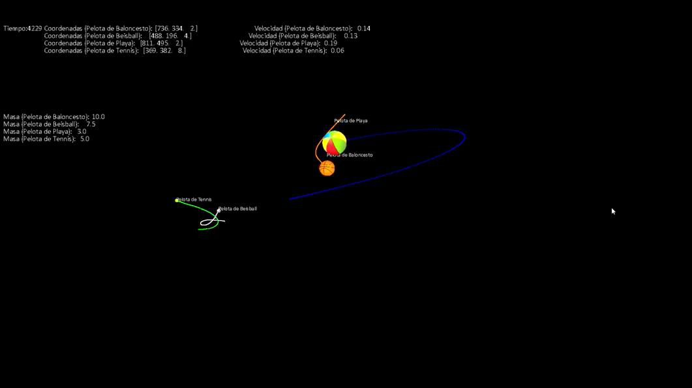
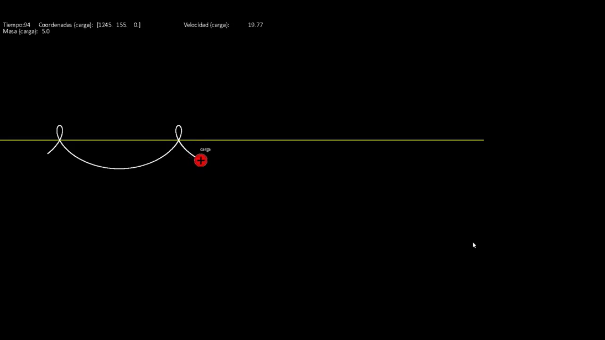

# PhysicsEngine

A 3D physics engine in Python and Pygame. It simulates bodies moving under gravitational, electric and magnetic
fields — Newton's law of universal gravitation, Coulomb's law and the Lorentz force — and draws them in real time
with a movable camera.

> **Written by me, by hand, in 2021–2023.** It began as my research project in the final year of high school
> (2º de Bachillerato, Colegio Marista La Inmaculada, Granada, 2021/22), across Mathematics II, Physics and ICT. I
> wrote it up as a research paper and presented it to Spain's XXXIV *Certamen Jóvenes Investigadores* (2023):
> [docs/research-paper.pdf](docs/research-paper.pdf), in Spanish. The code and its comments are in Spanish too.





## What it does

- **Forces**: gravity and the electric force between every pair of bodies, uniform fields, and the magnetic field of
  a straight current-carrying conductor acting on moving charges (Lorentz force).
- **Integration**: Runge-Kutta of configurable order (4 by default), with a configurable number of steps per frame.
  That trade-off was the core problem of the project: large time steps give unrealistic trajectories, and very small
  ones cost too much computation.
- **Checks**: collisions between bodies, and the system's mechanical energy, to verify that the integrator conserves
  it.
- **Rendering**: the 3D scene is projected onto the 2D window with perspective and a movable camera, with trails and
  on-screen readouts of each body's position, speed and mass.
- **Data-driven scenes**: every simulation is a folder of JSON files, so a new one is a copy of an existing folder with
  edited values.
- **Optimisation**: a genetic algorithm searches for initial conditions that reach a target — for example, the launch
  velocity a projectile needs to land on a given point.

## Included simulations

| Folder in `Simulaciones/` | What it shows |
|---|---|
| `Sistema Solar` | The Sun, the planets and Pluto |
| `N cuerpos` | Four balls of different mass attracting each other |
| `Prueba energia` | Two bodies, printing the system's total energy as it evolves |
| `carga y conductor` | A charge moving next to a straight conductor |
| `movimiento parabolico` | A projectile in a uniform gravitational field |

Each folder holds `Configuracion.json` (steps per frame, Runge-Kutta order, window size, trails), `Constantes.json`
(physical constants), `Camara.json` (initial camera), `Cuerpos/<name>/datos.json` (position, velocity, mass, charge
and radius, plus an `imagen.png` sprite) and, where needed, `Campos/<name>/datos.json`.

## Running it

Requires Python 3 with Pygame and NumPy, plus psutil for the genetic algorithm.

```sh
pip install pygame numpy psutil
python "Menu 2.1.py"   # choose a simulation and edit its parameters
python Fisica.py        # or run the engine directly
```

The Solar System scene computes 1,000,000 steps per frame by default (`Cantidad de calculos` in its
`Configuracion.json`), so it is slow; lower that number to try it quickly.

## Files

| File | What it is |
|---|---|
| `Fisica.py` | The engine: bodies, fields, Runge-Kutta integration, collisions, energy, camera and drawing |
| `Menu 2.1.py` | Menu to pick a simulation and change its parameters |
| `Algoritmo genético.py` | Genetic algorithm that tunes a simulation's parameters towards a target (`Objetivos.json`, `Parametros.json`) |
| `Fisica_IA.py` | The version of the engine that the genetic algorithm drives |
| `Fisica_falsa.py` | An experimental variant of the engine |

## Sources

Linked in the code: a YouTube tutorial by Gaston Carrera (top of `Fisica.py`) and a Stack Overflow answer on
mutations in neuroevolution (`Algoritmo genético.py`).
